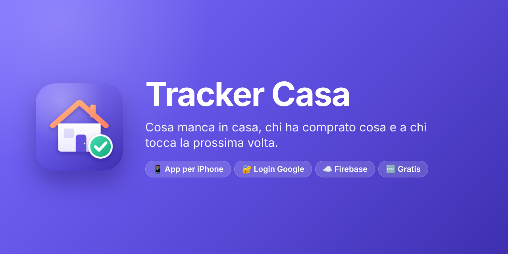
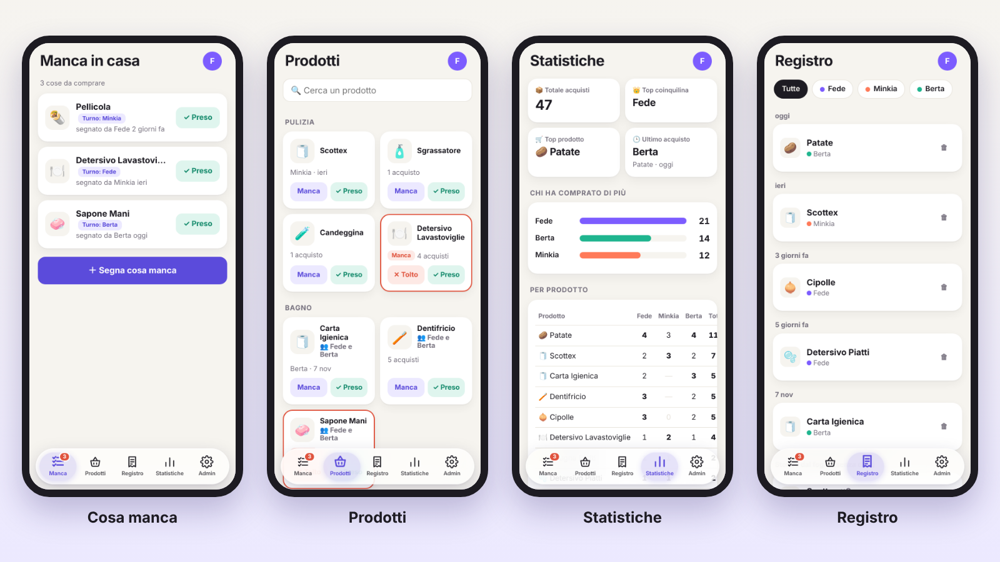

<p align="center"></p>

<p align="center">
  <a href="https://tracker-casa-a0c47.web.app"><b>🌐 Apri l'app</b></a> ·
  <a href="CHANGELOG.md">📝 Novità</a> ·
  <a href="https://github.com/TheRealJayser/tracker-casa/releases">🏷️ Release</a> ·
  
  
  
</p>

# 🏡 Tracker Casa

App per tre coinquiline: lista di **cosa manca in casa**, **registro acquisti**, **statistiche** (chi ha comprato di più, chi per ultimo, a chi tocca). Login con Google, solo account autorizzati. Si installa sull'iPhone come una vera app.

<p align="center"></p>

## ✨ Cosa fa

- 📝 **Manca in casa** — lista condivisa, con chi l'ha segnato e **a chi tocca** comprarlo.
- 🧺 **Prodotti** — per categoria, un tocco per "Manca" o "✓ Preso".
- 🛁 **Bagno condiviso** — ogni prodotto ha le sue partecipanti: ognuna vede solo le cose che compra anche lei.
- 🧾 **Registro** — tutti gli acquisti giorno per giorno.
- 📊 **Statistiche** — chi ha comprato di più, chi per ultimo, tabella prodotto × coinquilina.
- 🔐 **Accesso controllato** — si entra con Google, l'amministratore conferma chi è chi.
- 💾 **Backup Excel** — l'amministratore esporta tutti i dati in un file Excel e li può ripristinare da lì.

**Stack (tutto gratuito):** HTML/CSS/JS senza build · Firebase Authentication + Cloud Firestore + **Firebase Hosting** (piano Spark, senza carta di credito) · codice su GitHub.

---

## 1. Crea il progetto Firebase (dal browser, ≈10 minuti)

1. Vai su <https://console.firebase.google.com> → **Aggiungi progetto** → nome `tracker-casa` → Google Analytics: **disattiva** → Crea.
2. Menu **Build → Authentication** → *Inizia* → scheda *Metodo di accesso* → **Google** → Abilita → scegli la tua email di assistenza → Salva.
3. Menu **Build → Firestore Database** → *Crea database* → località **eur3 (Europe)** → *Avvia in modalità produzione* → Crea.
4. Scheda **Dati** → *Avvia raccolta*:
   - ID raccolta: `members`
   - ID documento: **la tua email Google, tutta minuscola** (es. `mario.rossi@gmail.com`)
   - Campo: `role` · tipo *string* · valore `admin` → Salva.
   (È l'unico dato da inserire a mano: da qui in poi gestisci tutto dall'app.)
5. ⚙️ **Impostazioni progetto** → in fondo *Le tue app* → icona **`</>`** (Web) → nickname `tracker-casa` → **spunta "Configura anche Firebase Hosting"** → Registra → Avanti fino alla fine (i comandi che ti mostra li facciamo sotto).

Le regole di sicurezza non vanno copiate a mano: le pubblica il comando `firebase deploy`.

## 2. Pubblica l'app

**Automatico (consigliato):** il repository GitHub `TheRealJayser/tracker-casa` pubblica da solo l'app a ogni modifica su `main` (GitHub Actions → `.github/workflows/deploy.yml`). Le regole di sicurezza si aggiornano dalla console Firebase → Firestore → Regole.

**In alternativa, dal Mac con il Terminale** (sui Mac con chip Apple serve prima `softwareupdate --install-rosetta --agree-to-license`):

Scompatta lo zip, poi apri il **Terminale**:

```bash
# 1) installa lo strumento Firebase (non serve Node; può chiederti la password del Mac)
curl -sL https://firebase.tools | bash

# 2) accedi con lo stesso account Google della console
firebase login

# 3) entra nella cartella dell'app (trascina la cartella nel Terminale dopo "cd ")
cd ~/Downloads/tracker-casa

# 4) pubblica app + regole di sicurezza (il progetto tracker-casa-a0c47 è già collegato nel file .firebaserc)
firebase deploy
```

Alla fine compare l'indirizzo dell'app, tipo **`https://tracker-casa-xxxx.web.app`**. Fatto: login su iPhone compreso, nessun'altra configurazione.

### Aggiornamenti automatici da GitHub (facoltativo)

1. Crea su GitHub un repository **privato** `tracker-casa` e carica i file (con GitHub Desktop o dal sito).
2. Nel Terminale, dentro la cartella: `firebase init hosting:github` → scrivi `tuonome/tracker-casa` → *build script?* **No** → *deploy automatico quando fai merge?* **Sì**, branch `main`.

Da quel momento ogni modifica caricata su `main` viene pubblicata da sola. Senza GitHub basta rilanciare `firebase deploy`.

## 3. Primo avvio

1. Apri l'indirizzo `…web.app`, **Accedi con Google** con l'account admin.
2. Scheda **Admin → Importa dati dal foglio Google**: crea le 3 coinquiline, i 15 prodotti e i 42 acquisti del foglio (come "storico senza data").
3. Manda il link alle ragazze: entrano con **il loro account Google** e vedono "Richiesta inviata".
4. Tu apri **Admin → 🔔 Richieste di accesso** e per ognuna tocchi chi è (Fede · Federica, Berta · Beatrice, Minkia · Rosi). L'app si apre da sola sul loro telefono, già filtrata sui loro prodotti.
   (In alternativa puoi ancora autorizzare un'email in anticipo con *Autorizza un account Google*.)

## 4. Installarla su iPhone

Apri il sito in **Safari** (non Chrome) → tasto **Condividi** → **Aggiungi alla schermata Home** → Aggiungi. Si apre a schermo intero come un'app, in verticale.

<details><summary>Android</summary>Chrome → menu ⋮ → <i>Installa app</i>.</details>

## Prodotti del bagno

Ogni prodotto ha i suoi **partecipanti** (Admin → Prodotti → tocca un prodotto → *Chi lo compra e lo vede?*).
- *Tutte*: lo vedono e lo comprano tutte e tre.
- Solo alcune: lo vedono solo loro; turni e statistiche contano solo loro.

All'import, **Carta Igienica, Dentifricio e Sapone Mani** sono assegnati a **Fede e Berta** (bagno in comune); Minkia non li vede.

---

## Come funziona

| Scheda | Cosa fa |
|---|---|
| 📝 **Manca** | Lista condivisa di cosa è finito. Per ogni voce: a chi tocca (chi l'ha comprato meno; a pari merito compaiono tutte), chi l'ha comprato per ultimo, chi l'ha segnato. "✓ Preso" registra l'acquisto e lo toglie dalla lista. |
| 🧺 **Prodotti** | Tutti i prodotti per categoria: "Manca" lo mette in lista, "✓ Preso" registra un acquisto (chi, quando, nota). |
| 🧾 **Registro** | Tutti gli acquisti per giorno, filtrabili per coinquilina. Ognuna può eliminare quelli che ha inserito lei; l'admin tutti. |
| 📊 **Statistiche** | Totale, top coinquilina, top prodotto, ultimo acquisto, classifica e tabella prodotto × coinquilina (come nel foglio). |
| ⚙️ **Admin** | Solo amministratore: account autorizzati, coinquiline, prodotti (aggiungi/modifica/archivia), import dal foglio, backup e ripristino Excel. |

### Dati su Firestore
- `members/{email}` → `role` (`admin`/`member`), `personId`
- `people/{id}` → `name`, `color`, `order`
- `products/{id}` → `name`, `emoji`, `category`, `order`, `archived`
- `purchases/{auto}` (storico del foglio: `seed-persona-prodotto`) → `productId`, `personId`, `date`, `note`, `createdBy`, `createdAt`, `historical`, `count` (solo storico)
- `missing/{productId}` → `addedBy`, `addedByEmail`, `addedAt`

La sicurezza è nelle regole (`firestore.rules`, pubblicate con `firebase deploy`): chi non è in `members` non legge e non scrive nulla.

### Backup Excel
**Admin → Backup → Esporta backup Excel** crea `tracker-casa-backup_data.xlsx` (su iPhone si apre *Condividi* → *Salva in File*). Fogli:
`Info`, `Coinquiline`, `Prodotti`, `Acquisti`, `Manca`, `Account` e `Riepilogo` (tabella prodotto × coinquilina, solo da leggere).

**Admin → Backup → Ripristina da Excel** legge lo stesso file:
- *Unisci* aggiunge/aggiorna usando le colonne **ID** → rifarlo due volte non crea doppioni;
- *Sostituisci tutto* rende l'app uguale al file (cancella ciò che nel file non c'è). Gli account non vengono mai tolti.

Le righe aggiunte a mano nel file vanno lasciate con l'**ID vuoto**. Il ripristino richiede le regole Firestore aggiornate alla 1.6.0.

## Limiti gratuiti (piano Spark)

Nessuna carta di credito, quindi **nessun addebito possibile**. Se un limite giornaliero venisse superato, quella parte si ferma fino al reset (le 9:00 circa, ora italiana) e poi riparte da sola. Per 3 persone siamo molto lontani:
- Hosting: 360 MB/giorno di traffico — l'app pesa ~120 KB e resta in cache sul telefono.
- Firestore: 50.000 letture e 20.000 scritture al giorno — un'apertura dell'app ne usa qualche decina.
- Le pubblicazioni (`firebase deploy`) non consumano traffico.

## Release

Ogni modifica è una release, registrata in `CHANGELOG.md`:
1. aumenta la versione in `version.js` **e** `CACHE` in `sw.js` (es. `1.0.0` → `1.1.0`);
2. aggiungi la voce in cima a `CHANGELOG.md`;
3. commit `Release vX.Y.Z` (il titolo della sezione nel CHANGELOG diventa il titolo della Release, creata in automatico da GitHub);
4. `firebase deploy` (o push su `main` se hai attivato il deploy automatico).

Versioni: **MAJOR** = cambia la struttura dati · **MINOR** = nuova funzione · **PATCH** = correzione.
